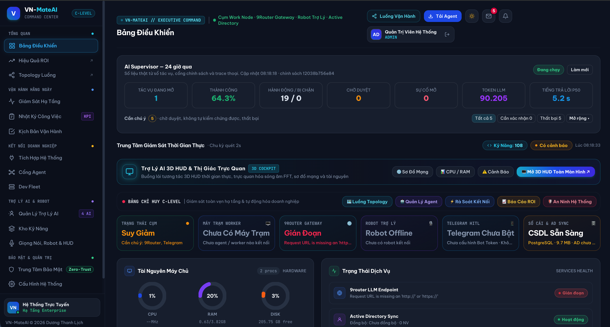
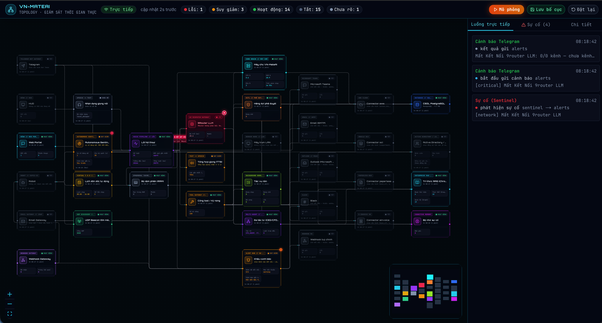
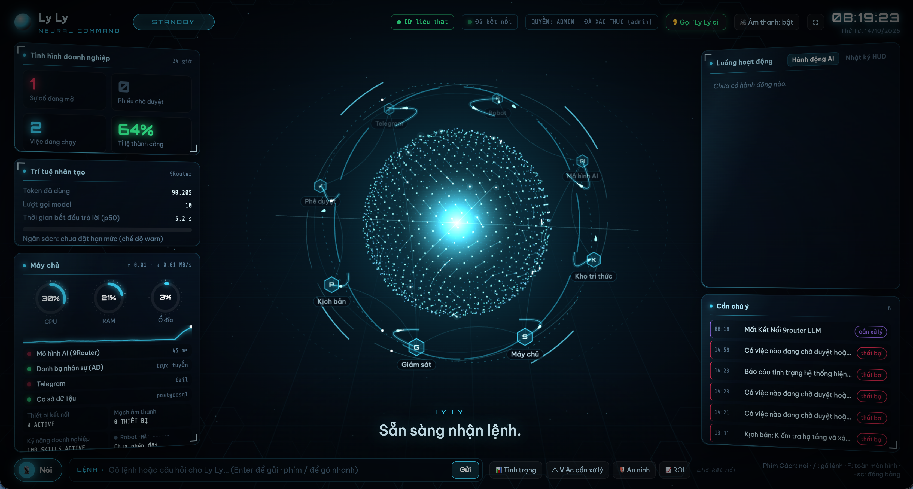
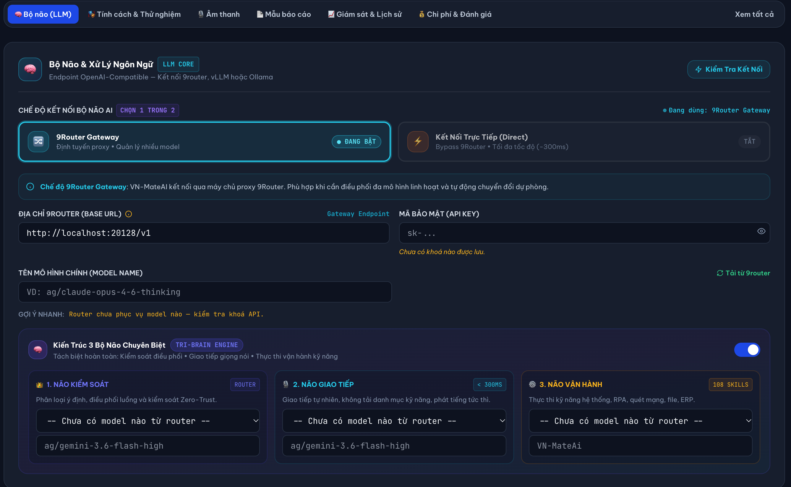
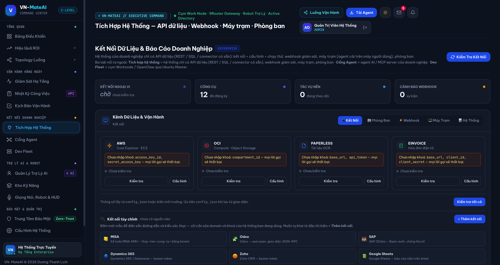
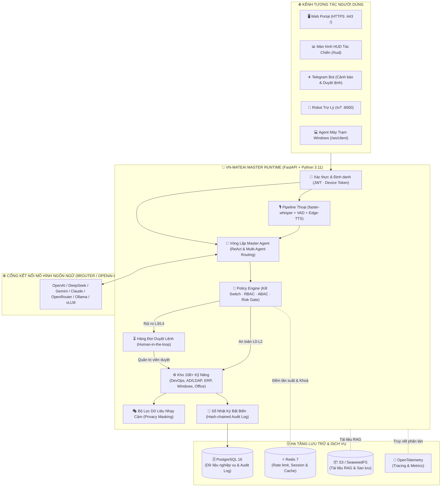

<div align="center">

# 🤖 VN-MateAI
### Nền Tảng Trợ Lý AI Vận Hành Doanh Nghiệp, Master Điều Phối Agent & Robot Trợ Lý

[](LICENSE)
[](https://python.org)
[](https://fastapi.tiangolo.com)
[](#-cài-đặt-nhanh-quick-start)
[](#-dữ-liệu--hạ-tầng)
[](#-dữ-liệu--hạ-tầng)
[](#-robot-trợ-lý)

<br/>

<p align="center">
  
</p>

**VN-MateAI** là giải pháp hạt nhân **Master Điều Phối Agent (Master Agent Orchestrator)** toàn diện cho doanh nghiệp. Hệ thống hợp nhất việc quản trị, vận hành hạ tầng, điều phối đội ngũ AI Agent chuyên trách (DevOps, IT, HR, Kế toán, Máy trạm, Robot phần cứng) hoạt động trên đa kênh: từ **Web Portal C-Level**, **Màn hình tương tác HUD 3D**, **Telegram & Teams Bot**, **Agent máy trạm Windows** cho đến **Robot Trợ Lý để bàn ESP32-S3**.

[Tổng Quan](#-tổng-quan--master-điều-phối-agent) • [Giao Diện Thực Tế](#-giao-diện-thực-tế-application-showcase) • [Tính Năng](#-tính-năng-nổi-bật) • [Kiến Trúc Tri-Brain](#-kiến-trúc-3-bộ-não-chuyên-biệt-tri-brain-engine) • [Cài Đặt](#-cài-đặt-nhanh-quick-start) • [Bảo Mật](#-an-toàn--quản-trị-ai-zero-trust) • [Giấy Phép](#-giấy-phép--bản-quyền)

</div>

---

## 🌟 Tổng Quan — Master Điều Phối Agent Doanh Nghiệp

Trong các tổ chức hiện đại, việc ứng dụng AI thường gặp tình trạng phân mảnh: mỗi phòng ban sử dụng một công cụ rời rạc, thiếu khả năng kiểm soát tập trung, không có cơ chế phân quyền bảo mật và không thể phối hợp chéo giữa các tác vụ.

**VN-MateAI được thiết kế để đóng vai trò Tổng Chỉ Huy (Master Orchestrator)** vận hành mọi mắt xích AI trong doanh nghiệp:

```
                                  ┌─────────────────────────────┐
                                  │      NGƯỜI DÙNG / SẾP       │
                                  │  Web Portal · HUD · Telegram│
                                  │   Robot ESP32 · Giọng Nói   │
                                  └──────────────┬──────────────┘
                                                 │
                                                 ▼
                       ╔═════════════════════════════════════════════════╗
                       ║        VN-MATEAI — MASTER ORCHESTRATOR         ║
                       ║    Tri-Brain Engine · Policy Gate · Zero Trust  ║
                       ╚═════════════════════════════════════════════════╝
                                                 │
         ┌───────────────────┬───────────────────┼───────────────────┬───────────────────┐
         ▼                   ▼                   ▼                   ▼                   ▼
┌─────────────────┐ ┌─────────────────┐ ┌─────────────────┐ ┌─────────────────┐ ┌─────────────────┐
│  AGENT DEVOPS   │ │  AGENT MÁY TRẠM │ │   AGENT ERP     │ │  ROBOT BÀN LÀM  │ │  AGENT AN NINH  │
│ Hạ tầng, Docker │ │  Windows Client │ │ MISA, SAP, Odoo │ │   ESP32-S3      │ │ Audit Log, PII  │
│  Server, Cloud  │ │  COM, Excel, App│ │  Hóa đơn, Thuế  │ │  Cảm xúc, Thoại │ │  Sentinel 24/7  │
└─────────────────┘ └─────────────────┘ └─────────────────┘ └─────────────────┘ └─────────────────┘
```

1. **Điều Phối Đa Tác Tử (Multi-Agent Swarm)**: Tiếp nhận một yêu cầu cấp cao từ ban điều hành, tự động phân tích ý định, bẻ nhỏ thành các chuỗi hành động và giao nhiệm vụ cho từng Agent chuyên môn phù hợp.
2. **Kiểm Soát Rủi Ro Tập Trung (Zero-Trust Gate)**: Mọi quyết định hay thao tác của bất kỳ Agent nào xuống hệ thống vật lý đều phải đi qua chốt chặn an toàn: đánh giá mức độ rủi ro (L0–L4), kích hoạt hàng đợi phê duyệt (Human-in-the-loop) trước khi thực thi.
3. **Giám Sát Toàn Cảnh Thời Gian Thực**: Trực quan hóa toàn bộ topology dòng chảy dữ liệu giữa các Agent, Webhook, cơ sở dữ liệu và máy trạm trên bảng điều khiển tương tác trực tiếp.

---

## 📸 Giao Diện Thực Tế (Application Showcase)

Dưới đây là hình ảnh thực tế từ các phân hệ vận hành chính của VN-MateAI:

### 1. Bảng Điều Khiển Trung Tâm Chỉ Huy (Executive Command Center)
Giao diện C-Level dành cho ban lãnh đạo và giám đốc CNTT: theo dõi tỷ lệ tác vụ thành công, lượng Token LLM tiêu thụ, thời gian phản hồi P50, cảnh báo sự cố hạ tầng và trạng thái kết nối các node trong mạng lưới.

<p align="center">
  
</p>

---

### 2. Sơ Đồ Topology Master Điều Phối Luồng & Agent Thời Gian Thực
Bản đồ trực quan hóa toàn bộ cấu trúc điều phối của VN-MateAI: từ các cổng đón lệnh (Telegram, HUD, Web Portal, Robot, Email, Webhook), qua Sentinel tự hành, lõi Voice STT/TTS, AI Dispatch Gateway (9Router), Tool Gateway (108 kỹ năng), Hàng đợi duyệt, Đa tác tử (Multi-Agent), tới hạ tầng CSDL, Active Directory, Cloud và hệ thống ERP.

<p align="center">
  
</p>

---

### 3. Màn Hình Tác Chiến HUD 3D Buồng Lái (Mission Control Cockpit)
Thiết kế tối ưu cho màn hình lớn treo tường phòng điều hành (NOC): trang bị quả cầu thần kinh 3D phản ứng thời gian thực theo âm thanh và trạng thái hệ thống, hiển thị chỉ số sức khỏe máy chủ, telemetry và hỗ trợ tương tác giọng nói trực tiếp.

<p align="center">
  
</p>

---

### 4. Kiến Trúc 3 Bộ Não Chuyên Biệt (Tri-Brain Engine)
Cấu hình phân tách rạch ròi 3 tầng mô hình AI: **Não Kiểm Soát (Router Zero-Trust)** phân tích luồng $\rightarrow$ **Não Giao Tiếp (<300ms)** phản hồi tức thì $\rightarrow$ **Não Vận Hành (108 Skills)** thực thi tác vụ chuyên sâu. Tương thích linh hoạt với mọi Gateway LLM (Gemini, Claude, GPT, DeepSeek, vLLM, Ollama).

<p align="center">
  
</p>

---

### 5. Trung Tâm Tích Hợp Doanh Nghiệp (ERP, Cloud & Workstations)
Kết nối sẵn sàng với các hệ thống CNTT doanh nghiệp hàng đầu: AWS, Oracle Cloud OCI, Hóa đơn điện tử, Paperless OCR, phần mềm kế toán MISA, ERP Odoo, SAP, Microsoft Dynamics 365, Zoho và Google Sheets.

<p align="center">
  
</p>

---

## 🧠 Kiến Trúc 3 Bộ Não Chuyên Biệt (Tri-Brain Engine)

Khác với các ứng dụng AI thông thường dồn toàn bộ prompt vào một mô hình duy nhất dẫn đến độ trễ cao và dễ ảo giác (hallucination), VN-MateAI áp dụng cơ chế **Tri-Brain**:

| Bộ Não | Chức Năng Chính | Mô Hình Khuyên Dùng | Thời Gian Phản Hồi |
|---|---|---|---|
| **1. Não Kiểm Soát** *(Router)* | Phân tích ý định, kiểm tra phân quyền RBAC/ABAC, chặn lệnh nguy hiểm, điều phối luồng sang Agent phụ trách | Mô hình suy luận nhanh: `gemini-3.6-flash-high`, `gpt-4o-mini`, `deepseek-chat` | ~100–200 ms |
| **2. Não Giao Tiếp** *(Conversational)* | Giao tiếp thoại tự nhiên, không phải nạp danh mục kỹ năng cồng kềnh, sinh câu phản hồi thoại mượt mà | Mô hình streaming tốc độ cao: `gemini-3.6-flash`, `gpt-4o-mini` | **< 300 ms** |
| **3. Não Vận Hành** *(Execution)* | Nạp 108+ công cụ (Skills), lập kế hoạch ReAct, thực thi code, truy vấn SQL, gọi API ERP, điều khiển máy trạm | Mô hình thông minh cao: `claude-3-7-sonnet`, `gemini-1.5-pro`, `gpt-4o` | Theo độ phức tạp tác vụ |

---

## ✨ Tính Năng Nổi Bật

### 🎙️ 1. Đường Ống Thoại Tiếng Việt Thời Gian Thực (Full-Duplex Voice)
- **STT Offline / Online**: Nhận dạng giọng nói tiếng Việt bằng **faster-whisper** chạy cục bộ kết hợp bộ lọc âm thanh **Silero VAD**, có phương án dự phòng đám mây (Groq).
- **TTS mượt mà & Truyền phát phân đoạn**: Tích hợp Edge-TTS chất lượng cao, Vbee, ElevenLabs. Tách câu thông minh để đọc ngay khi mô hình LLM vừa sinh dữ liệu, độ trễ phản hồi cực thấp.
- **Barge-in (Ngắt lời tức thì)**: Khi người dùng nói lệnh mới, hệ thống tự động hủy lượt đọc cũ để lắng nghe ngay lập tức.
- **Wake Word đa thiết bị**: Hỗ trợ gọi trợ lý bằng từ đánh thức thông minh (*"Ly Ly"*, *"MateAI"*).

### 🤖 2. Robot Để Bàn ESP32-S3 (Robot Trợ Lý)
- Giao tiếp hai chiều với robot phần cứng ESP32-S3 qua giao thức WebSocket IoT độc lập (cổng `8000`).
- Hiển thị cảm xúc, trạng thái lắng nghe, phản hồi âm thanh trực tiếp tại bàn làm việc của nhân viên hoặc phòng họp điều hành.

### 💻 3. Agent Tự Động Hóa Máy Trạm Windows (`client_agent`)
- Ứng dụng chạy nền gọn nhẹ (`VNMateAgent.exe`), không đòi hỏi cài đặt môi trường Python trên từng máy client.
- **Khả năng tự động hóa mạnh mẽ**:
  - Điều khiển tác vụ: mở ứng dụng, điều chỉnh âm lượng, điều khiển media, clipboard, chạy lệnh PowerShell có kiểm soát.
  - Tự động hóa bảng tính Excel qua Windows COM interface.
  - Giám sát sức khỏe máy trạm: chụp màn hình hỗ trợ kỹ thuật, kiểm tra tiến trình, kết nối mạng và thiết bị ngoại vi.
  - Giao diện popup thông báo nhắc việc và HUD mini nổi trên màn hình.

### 🛡️ 4. An Toàn & Quản Trị AI (Zero-Trust Governance)
- **Policy Engine 5 lớp**: Kill-switch toàn cục → Bộ lọc công cụ cấm → Phân quyền vai trò (RBAC) → Phân quyền ngữ cảnh (ABAC theo phòng ban & cấp bảo mật) → Đánh giá mức rủi ro.
- **Phân loại rủi ro L0–L4**:
  - *L0–L2 (Đọc dữ liệu, kiểm tra)*: Tự động phê duyệt và thực thi.
  - *L3 (Ghi, sửa đổi, xóa, cấu hình)*: Tạm giữ vào hàng đợi phê duyệt, gửi thông báo đến người có thẩm quyền qua Web Portal hoặc Telegram.
  - *L4 (Lệnh nhạy cảm cao)*: Yêu cầu ủy quyền định danh có giới hạn thời gian.
- **Chế độ khẩn cấp (Emergency Lockdown)**: Khi phát hiện AI thao tác dồn dập hoặc bất thường, hệ thống tự động khóa chế độ ghi, chuyển toàn bộ sang chỉ đọc.
- **Nhật ký Audit chống giả mạo (Tamper-proof)**: Bảng `audit_logs` hoạt động theo mô hình *Append-Only*, mỗi bản ghi chứa chuỗi băm mật mã (`prev_hash`, `row_hash`) và trigger cơ sở dữ liệu ngăn chặn hoàn toàn việc sửa/xóa.
- **Bảo mật dữ liệu cá nhân (Privacy Engine)**: Tự động che giấu CCCD, Số điện thoại, Lương, Mật khẩu theo cấp độ quyền hạn người dùng trước khi hiển thị hoặc gửi tới LLM.

### 📊 5. Giao Diện Điều Hành Trực Quan
- **Web Portal (`https://<host>/`)**: Trung tâm điều khiển toàn diện cho người dùng và quản trị viên: hội thoại văn bản & giọng nói, hàng đợi phê duyệt, quản lý danh bạ nhân sự, thiết bị IoT, kho tri thức (RAG) và cấu hình hệ thống.
- **Màn hình tác chiến HUD (`https://<host>/hud`)**: Thiết kế dạng Dark Mode tối ưu cho màn hình lớn treo tường phòng điều hành: hiển thị telemetry máy chủ, trạng thái hệ sinh thái, lệnh thoại trực ban và nút duyệt nhanh.
- **Bảng phân tích giá trị ROI (`/roi`)**: Đo lường hiệu quả vận hành và số giờ công tiết kiệm được tính toán từ dữ liệu thực tế.

---

## 🏛️ Kiến Trúc Luồng Hệ Thống



---

## 🚀 Cài Đặt Nhanh (Quick Start)

### Yêu Cầu Phần Cứng & Môi Trường
- **Hệ điều hành**: Linux (Ubuntu 22.04/24.04, Debian 12), macOS (Apple Silicon / Intel), hoặc Windows 10/11 / Server.
- **Docker**: Docker Engine + Docker Compose v2 (hoặc Docker Desktop).
- **Tài nguyên tối thiểu**: 4 Cores CPU, 8 GB RAM, 20 GB dung lượng ổ cứng khả dụng.
- **Cổng mạng**: Cần mở cổng `443` (Web Portal HTTPS) và `8000` (Giao thức IoT cho Robot).
- **Mô hình AI**: Có sẵn URL, API Key của nhà cung cấp LLM tương thích chuẩn OpenAI (OpenAI, DeepSeek, Google Gemini, OpenRouter, hoặc Proxy nội bộ).

---

### Phương Pháp 1: Cài Đặt Tự Động Bằng 1 Câu Lệnh (Khuyên Dùng)

#### Trên Linux / macOS:
```bash
# Clone dự án về máy
git clone https://github.com/lichpppp5/VN-MateAI-v2.0.git
cd VN-MateAI-v2.0

# Chạy trình cài đặt tự động
sudo ./install.sh        # Trên Linux
# hoặc:
bash install.sh          # Trên macOS (Cấp tối thiểu 8GB RAM trong Docker Desktop)
```

#### Trên Windows (PowerShell với quyền Administrator):
```powershell
# Clone dự án về máy
git clone https://github.com/lichpppp5/VN-MateAI-v2.0.git
cd VN-MateAI-v2.0

# Chạy script cài đặt tự động
powershell -ExecutionPolicy Bypass -File .\install.ps1
```

> **Trình cài đặt sẽ tự động**:
> 1. Tự sinh tệp cấu hình `.env` với các mật khẩu ngẫu nhiên an toàn tuyệt đối (cho `admin`, `PostgreSQL`, `Redis`).
> 2. Dò tìm địa chỉ IP mạng nội bộ (LAN) của máy chủ để thuận tiện kết nối từ máy trạm và robot.
> 3. Hỗ trợ nhập kết nối Mô hình AI (hoặc bấm Enter để cấu hình trực quan trên Web Portal sau).
> 4. Khởi chạy toàn bộ hệ thống bằng Docker Compose và kiểm tra trạng thái sức khỏe dịch vụ cho tới khi sẵn sàng.

---

### Phương Pháp 2: Triển Khai Thủ Công Bằng Docker Compose

1. **Khởi tạo tệp môi trường từ mẫu**:
   ```bash
   cp env.example .env
   ```
2. **Điền các thông tin trong `.env`**:
   - Thiết lập `VNMATE_ADMIN_PASSWORD`, `VNMATE_PG_PASSWORD`, `VNMATE_REDIS_PASSWORD`.
   - Cung cấp `VNMATE_LLM_BASE_URL`, `VNMATE_LLM_API_KEY`, `VNMATE_LLM_MODEL`.
3. **Khởi động dịch vụ**:
   ```bash
   docker compose up -d --build
   ```
4. **Xem nhật ký hoạt động**:
   ```bash
   docker compose logs -f app
   ```

---

## 🔑 Truy Cập & Sử Dụng

Sau khi quá trình khởi động hoàn tất:

| Giao diện | Địa chỉ truy cập | Ghi chú |
|---|---|---|
| **Web Portal** | `https://<IP_MÁY_CHỦ>/` | Trung tâm quản trị, điều hành, chat & gọi thoại |
| **Màn hình HUD** | `https://<IP_MÁY_CHỦ>/hud` | Màn hình tác chiến trực ban giám sát |
| **API Healthcheck** | `https://<IP_MÁY_CHỦ>/livez` | Kiểm tra trạng thái hoạt động của hệ thống |

- **Tài khoản mặc định**: `admin`
- **Mật khẩu**: Xem thông báo in ra ở cuối script cài đặt hoặc kiểm tra biến `VNMATE_ADMIN_PASSWORD` trong tệp `.env`.
- ⚠️ *Lưu ý*: Lần đầu truy cập, trình duyệt sẽ cảnh báo chứng chỉ HTTPS tự ký (Self-signed certificate). Vui lòng chọn **"Advanced" (Nâng cao) -> "Proceed to..." (Vẫn tiếp tục)**. Để dùng chứng chỉ chính thức (Let's Encrypt / CA doanh nghiệp), bạn chỉ cần copy `server.crt` và `server.key` vào thư mục `certs/`.

---

## ⚙️ Cấu Hình Hệ Thống

Toàn bộ cấu hình chuyên sâu có thể điều chỉnh trực tiếp trên giao diện **Web Portal -> Quản Lý Trợ Lý AI**:

```
Portal -> Cài Đặt Hệ Thống
 ├── 🧠 Bộ Não (LLM): Cấu hình URL, API Key, Model chính, Model dự phòng, Tri-Brain
 ├── 🎙️ Giọng Đọc (TTS): Chọn Edge-TTS (tiếng Việt tự nhiên), Vbee, ElevenLabs
 ├── ✈️ Telegram Bot: Điền Bot Token & Chat ID để nhận cảnh báo và duyệt lệnh từ xa
 ├── 🛡️ Bảo Mật: Cấp phát Token định danh riêng cho từng Robot Trợ Lý
 ├── 👥 Phân Quyền & Privacy: Cấu hình quy tắc che dữ liệu (CCCD, SĐT, tài chính...)
 └── 💾 Sao Lưu: Thiết lập cơ chế sao lưu định kỳ
```

> **Tính năng tự động mã hóa**: Toàn bộ API Key và mật khẩu lưu trên máy chủ được tự động mã hóa AES đối xứng thông qua khóa bí mật `certs/config_secret.key`. Ngay cả khi tệp cấu hình bị đọc trộm, các khóa API của doanh nghiệp vẫn an toàn.

---

## 💻 Cài Đặt Agent Máy Trạm Windows

Để trợ lý AI có thể hỗ trợ điều khiển ứng dụng, chụp màn hình trợ giúp, tự động hóa Office Excel trên từng máy tính làm việc:
1. Mở Web Portal bằng địa chỉ IP LAN của máy chủ (ví dụ: `https://192.168.1.10/`).
2. Bấm vào nút **"Tải Agent"** trên thanh điều hướng.
3. Giải nén gói zip vừa tải trên máy tính Windows người dùng và bấm đúp vào `VNMateAgent.exe`.
4. Agent sẽ tự động kết nối về máy chủ, xác thực chứng chỉ và hiển thị biểu tượng tại khay hệ thống (System Tray).

---

## 🛠️ Vận Hành & Bảo Trì

### Các Lệnh Thường Dùng

```bash
# Xem trạng thái các container
docker compose ps

# Xem nhật ký trực tiếp của ứng dụng
docker compose logs -f app

# Dừng hệ thống
docker compose down

# Khởi động lại ứng dụng
docker compose restart app

# Sao lưu nhanh toàn bộ CSDL và dữ liệu cấu hình
./backup.sh
```

### Sao Lưu & Phục Hồi Dữ Liệu
Script `backup.sh` sẽ tự động sao lưu:
- Cơ sở dữ liệu PostgreSQL (`backups/db-<timestamp>.sql.gz`)
- Dữ liệu tri thức, cấu hình mã hóa và chứng chỉ (`backups/appdata-<timestamp>.tgz`)

**Phục hồi từ bản sao lưu:**
```bash
docker compose down
docker volume rm vnmateai_pgdata vnmateai_appdata
docker compose up -d postgres && sleep 10

# Khôi phục CSDL
gunzip -c backups/db-<timestamp>.sql.gz | docker compose exec -T postgres psql -U vnmate -d vnmate

# Khôi phục dữ liệu cấu hình
docker run --rm --user 0 --entrypoint tar -v vnmateai_appdata:/data -v "$PWD/backups:/b" vnmateai/app:1.0.0 \
  xzf /b/appdata-<timestamp>.tgz -C /data

# Khởi chạy lại toàn bộ dịch vụ
docker compose up -d
```

---

## 🔒 Quy Chuẩn An Toàn & Bảo Mật

1. **Không Hardcode Khóa Bí Mật**: Mã nguồn dự án tuân thủ nghiêm ngặt nguyên tắc Zero-Secret trong Git. Tệp `.env` cục bộ và các chứng chỉ `certs/` được bảo vệ tự động bởi `.gitignore`.
2. **PostgreSQL & Redis Không Mở Cổng Ra Ngoài**: Trong Docker Compose, cổng 5432 và 6379 chỉ giao tiếp trong mạng nội bộ Docker bridge network, ngăn chặn triệt để nguy cơ dò quét từ bên ngoài.
3. **Audit Log Toàn Vẹn Tuyệt Đối**: CSDL sử dụng Database Trigger chặn đứng mọi lệnh `UPDATE` hoặc `DELETE` trên bảng lịch sử tác vụ `audit_logs`. Hệ thống cung cấp API đối soát chuỗi băm:
   `GET /api/v1/security/audit-logs/verify`

---

## 🤝 Đóng Góp Phát Triển (Contributing)

Chúng tôi hoan nghênh mọi đóng góp từ cộng đồng! Nếu bạn muốn đóng góp tính năng mới hoặc báo cáo lỗi:
1. Fork dự án trên GitHub.
2. Tạo nhánh tính năng mới (`git checkout -b feature/tinh-nang-moi`).
3. Commit các thay đổi (`git commit -m 'Thêm kỹ năng tích hợp mới'`).
4. Push lên nhánh của bạn (`git push origin feature/tinh-nang-moi`).
5. Mở một **Pull Request** trên GitHub.

Vui lòng xem chi tiết tại [CONTRIBUTING.md](app/CONTRIBUTING.md).

---

## 📄 Giấy Phép & Bản Quyền

Dự án được phân phối dưới giấy phép mã nguồn mở **Apache License 2.0**. Xem chi tiết tại [LICENSE](app/LICENSE) và [NOTICE](app/NOTICE).

- **Tác giả & Chủ sở hữu bản quyền**: **Dương Thanh Lịch** ([thanhlich.duong@gmail.com](mailto:thanhlich.duong@gmail.com))
- **Kho lưu trữ chính thức**: [https://github.com/lichpppp5/VN-MateAI-v2.0](https://github.com/lichpppp5/VN-MateAI-v2.0)

---

<div align="center">
⭐ Nếu bạn thấy dự án hữu ích, hãy tặng một <b>Star</b> trên GitHub để ủng hộ đội ngũ phát triển! ⭐
</div>
